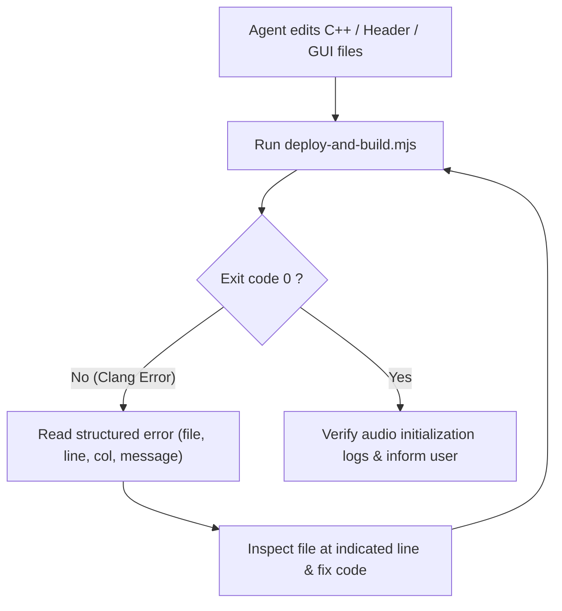

# Bela Autonomous Dev Deploy & Build Toolchain

This skill provides an automated, closed-loop development toolchain for the Bela Gem Multi board.  
It replaces manual file uploads and web IDE interactions by allowing you to deploy code, run native ARM compilation on the board, parse compiler errors directly, apply fixes, and re-deploy until the audio engine is running cleanly.

---

## The Autonomous Dev Loop (Build ➔ Diagnose ➔ Fix ➔ Re-deploy)

When modifying DSP, hardware configurations, or front-end GUI code:



---

## Source Directory Scope: `/src` Only

> [!IMPORTANT]
> **Strict `/src` Scope:** Only files and folders located inside the `src/` directory are deployed to the Bela board (`/root/Bela/projects/<project>/`).  
> - **Transferred:** C++ source and header files (`*.cpp`, `*.h`), `render.cpp`, `config.json`, `LOGO.png`, `src/samples/` (if present), and the bundled `src/sketch.js`.
> - **Excluded from Bela:** `node_modules/`, `.git/`, `.vscode/`, `docs/`, `gui/` (ES6 source files), `scripts/`, `test/`, and `.agents/`.
> - **GUI Bundling:** Before transfer, `gui/` is bundled into `src/sketch.js` via esbuild so Bela only receives the single required frontend bundle.

---

## How to Execute Deployment

Run the helper script from the workspace root:

```powershell
node .agents/skills/bela-dev-deploy/scripts/deploy-and-build.mjs
```

### Supported Flags:
- `--force` (or `-f`): Forces a full upload of all files in `src/`, bypassing MD5 hash delta checks.
- `--json`: Outputs a machine-readable JSON object containing status, parsed compiler diagnostics, and runtime logs.
- `--build-only`: Synchronizes files and runs compilation on Bela without launching the audio engine.
- `--skip-gui`: Skips rebuilding `src/sketch.js` (useful if you only touched C++ DSP files).
- `--stop`: Stops the currently active program on the Bela board.
- `--project=<name>`: Explicitly overrides the Bela project name (by default, it auto-detects from `/root/Bela/settings.json` or uses the repository directory name).

### Incremental Delta Synchronization:
By default, the script compares MD5 hashes of local `src/` files against remote files on Bela.  
- **Only modified files** are sent via SCP.
- Unmodified files retain their remote `mtime` timestamp, allowing GNU Make to perform lightning-fast incremental builds (~1 to 2 seconds instead of ~45s).

---

## Interpreting Errors and Auto-Correcting

When compilation fails, the script outputs actionable diagnostics:

```
❌ [DEPLOY & BUILD FAILED]
Stage:   compilation
Message: Compilation failed on Bela.

Found 1 actionable diagnostic(s):
  📍 src/render.cpp:184:5 -> [error] use of undeclared identifier 'kInvalidConstant'
     > kInvalidConstant = 12;
```

### Action for the Agent:
1. Note the exact file and line number: `src/render.cpp:184`.
2. Read the surrounding lines using `read_file`.
3. Fix the syntax, missing include, or type error using `edit_file`.
4. Re-run `node .agents/skills/bela-dev-deploy/scripts/deploy-and-build.mjs`.
5. Repeat until exit code is 0.

Consult [references/troubleshooting.md](./references/troubleshooting.md) for recurring Bela / Xenomai / ARM compiler subtleties.
